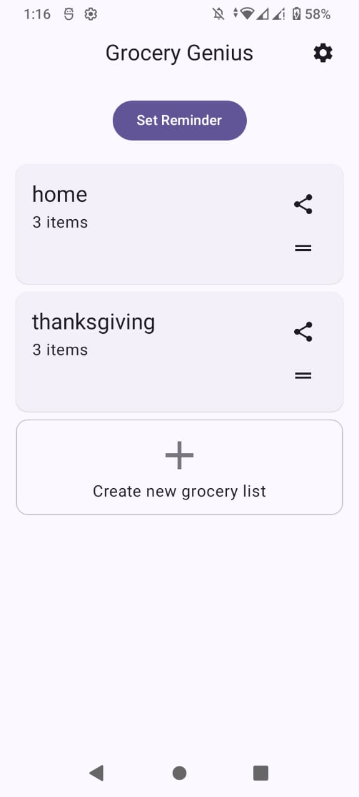
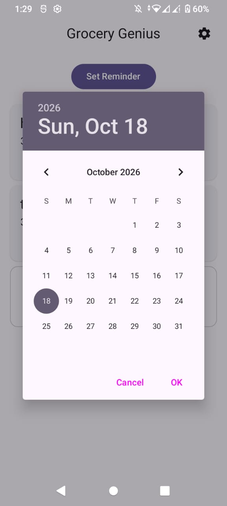
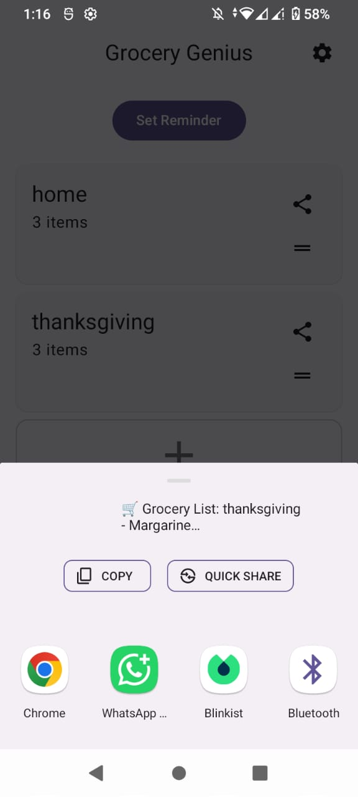

# Grocery Genius (Fork)

A free, customizable Android shopping list app with a modern grid design, autocomplete suggestions, offline support, **reminders**, and **list sharing**.

> **This is a fork of [Grocery Genius](https://github.com/DanielRendox/GroceryGenius) by [Daniel Rendox](https://github.com/DanielRendox).**
> All credit for the original app, architecture, and design goes to the original author. See [What's new in this fork](#whats-new-in-this-fork) for my additions.

## Screenshots

| Multiple grocery lists | Reminders | Share lists |
|:---:|:---:|:---:|
|  |  |  |

## What's new in this fork

- **Create multiple grocery lists:** make as many separate lists as you need (weekly shop, party, pharmacy, etc.).
- **Reminders:** set a reminder and get notified when it's time to shop.
- **Share grocery lists:** send a list to WhatsApp or any other app through the Android share sheet.

## Features

- **Add groceries in a few taps.** 130+ predefined groceries, each with its own icon. Type two letters and the best matches appear.
- **Add, edit, and delete groceries.** Items not in the database are created automatically; categorize them, assign an icon, or remove them.
- **Modern design.** A grid view with icons, color-coded purchased/unpurchased items, and groceries sorted by store category. Follows Material You with dynamic color, dark/light modes, and six color schemes.
- **Manage separate lists.** Create multiple lists and reorder them with drag-and-drop.
- **Reminders.** Never forget a shopping trip.
- **Share lists.** Send a list to family, friends, or roommates.
- **Customization.** Default list, category order, theme, and color scheme.
- **Offline mode.** An internet connection is only needed on first launch to fetch the predefined groceries.
- **Free and open source.** No limits, no ads.

## Get the app

Download the APK from the [Releases](https://github.com/aroobaaaaaaaa/Grocery-Genius/releases) page, or build it yourself:

1. Clone the repository:
   ```bash
   git clone https://github.com/aroobaaaaaaaa/Grocery-Genius.git
   ```
2. Open it in the latest version of [Android Studio](https://developer.android.com/studio).
3. Let Gradle sync, then run the `app` configuration on a device or emulator.

## Tech stack

- Jetpack Compose (single Activity, no Fragments)
- Hilt for dependency injection
- Room for local storage
- Retrofit + Moshi for networking and JSON decoding
- Preferences DataStore for simple key-value data
- Kotlin coroutines and Flow
- WorkManager for background sync
- Coil for image loading
- RecyclerView + ItemTouchHelper for drag-and-drop
- MVI pattern with a CLEAN architecture (data and presentation layers)

## Project structure

```
app/src/main/kotlin/com/rendox/grocerygenius/
├── data/            # Repositories (category, grocery, grocerylist, icons, product, userpreferences) and models
├── database/        # Room DAOs and entities
├── datastore/       # Preferences and change-list version data sources
├── feature/         # UI features, each with its own ViewModel, UI state, and intents
│   ├── addgrocery/
│   ├── dashboardscreen/
│   ├── editgrocery/
│   ├── grocerylist/
│   ├── iconpicker/
│   ├── onboarding/
│   └── settings/
├── filestorage/     # Asset saving, JSON decoding, unzip utilities
├── model/           # Shared domain models
├── network/         # GitHub API, data sources, DI
├── sync/work/       # Background sync with WorkManager
└── ReminderReceiver # Reminder notifications
```

## How it works

Predefined groceries are not bundled in the APK. They are fetched from the top-level `assets` folder of the original repository using the GitHub REST API, then cached locally in Room:

- A WorkManager task runs on each app startup and syncs each repository in sequence.
- Each repository compares the remote change-list version with the local one (stored in DataStore) and only downloads data when it's outdated.
- Images are downloaded and saved to internal storage (rather than loaded on demand by Coil), so the app stays fully functional offline. On first sync, an archive of all images is fetched in one request.
- Drag-and-drop on the Dashboard and Settings screens uses RecyclerView and ItemTouchHelper embedded in Compose, since Compose has no official drag-and-drop yet.

## Privacy

All data you enter is stored locally on your device. There are no ads, no analytics, and no registration. The app does not ask for your name, email, phone number, or other personal information.

The internet is used to fetch and update the grocery database from GitHub. `<If your sharing feature sends data anywhere other than via the Android share sheet, describe it here.>`

See [PRIVACY_POLICY.md](PRIVACY_POLICY.md) for details.

## Contributing

Issues and pull requests are welcome, whether it's bug reports, translations, design improvements, or new features.

Translations for the original app are managed on [Crowdin](https://crowdin.com/project/grocery-genius).

## License

This project is licensed under the **GNU General Public License v3.0**, the same license as the original project. See [LICENSE](LICENSE).

**Grocery icons are excluded.** The icons in `assets/icons` (and their duplicates in `app/src/debug/assets/icons`) were generated by Bing Image Creator and Recraft AI and are owned by the companies behind those services. **No commercial use of these icons is allowed.**

## Credits

- Original app: [Grocery Genius](https://github.com/DanielRendox/GroceryGenius) by [Daniel Rendox](https://github.com/DanielRendox)
- Fork maintained by [arooba](https://github.com/aroobaaaaaaaa)